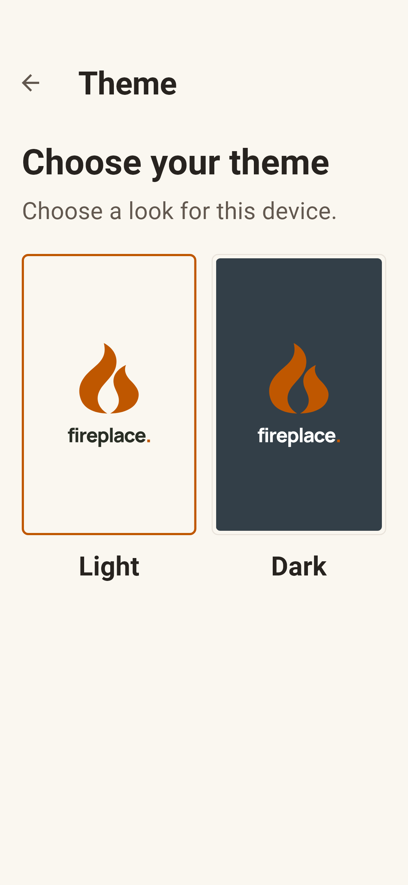
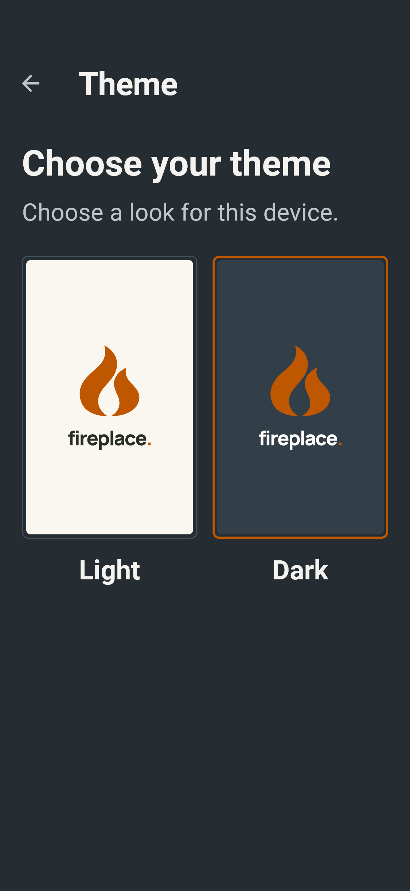
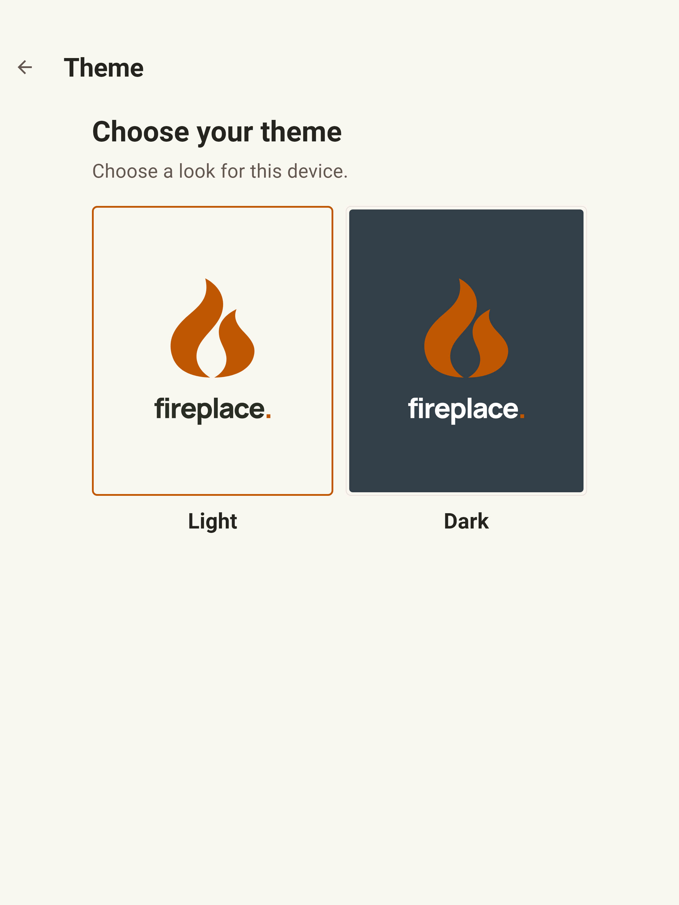
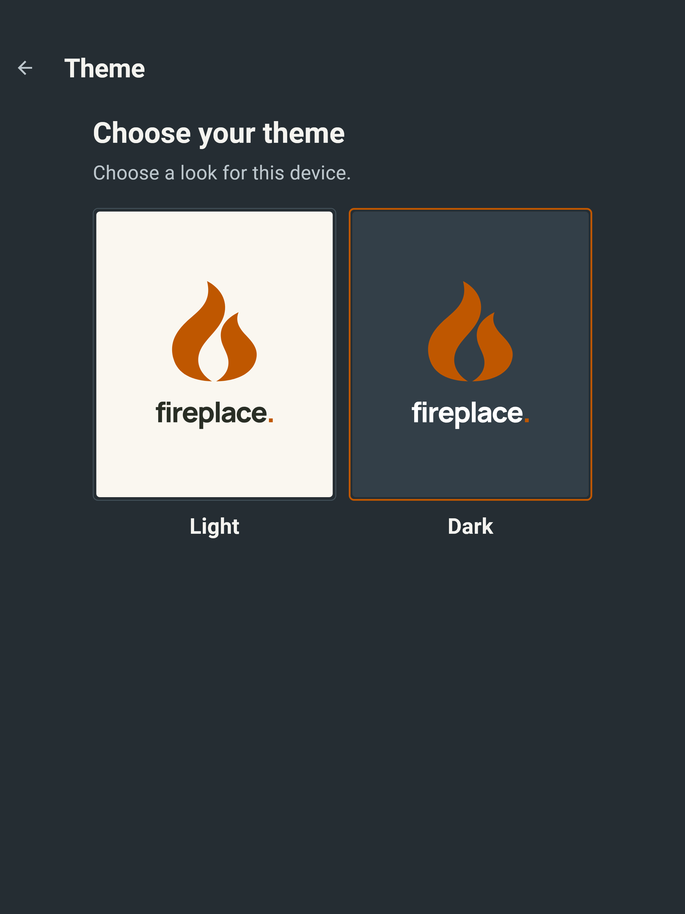
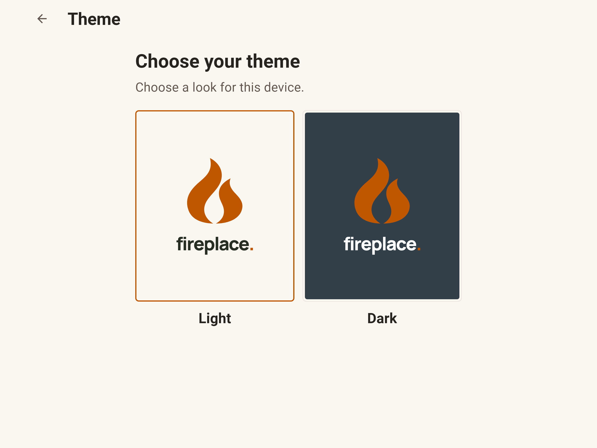
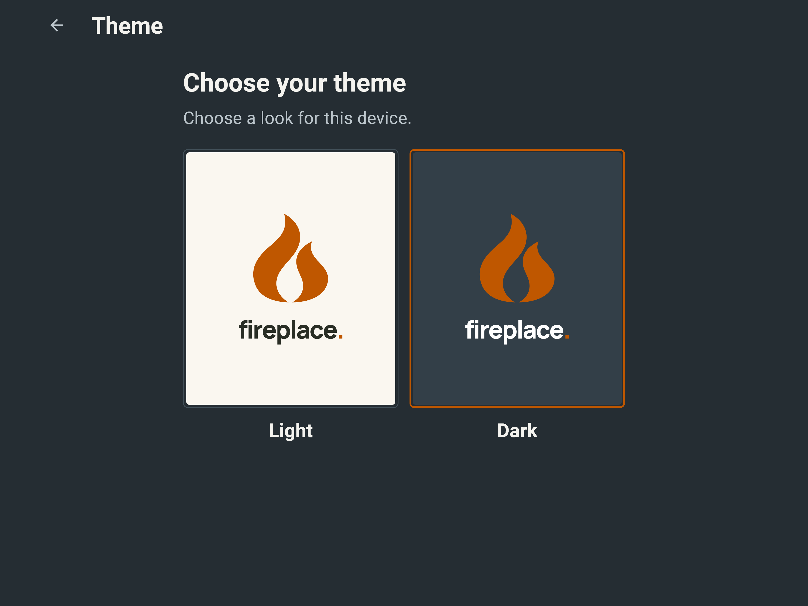

# Theme picker (#116)

Screenshots of the real page opened from Settings, using fictional in-memory
fixtures. The owner approved this v4 design for phones and tablets. The heading
and description stay at the top left of the content area; the two previews sit
side by side, with subtle corners and centered Light/Dark labels underneath.
Only the selected preview has the accent outline. There is no checkbox.

These captures use a text scale of 1.35 and three pixels per logical pixel.
They are widget renders, not screenshots from physical devices.

| Viewport | Light | Dark |
| --- | --- | --- |
| Phone, 375 × 812 |  |  |
| Tablet portrait, 768 × 1024 |  |  |
| Tablet landscape, 1024 × 768 |  |  |

Reproduce these and the smaller-phone, enlarged-text and phone-landscape cases:

```sh
TZ=UTC flutter test scripts/render/render_screens_test.dart --name=theme-picker
```

The images are written to `build/renders/`. The complete catalog also checks the
existing settings and chat-color screens. Theme choices keep using the existing
local preference store; there are no new dependencies or server operations.
