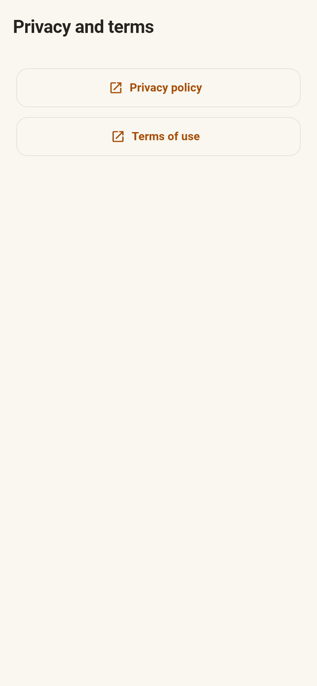
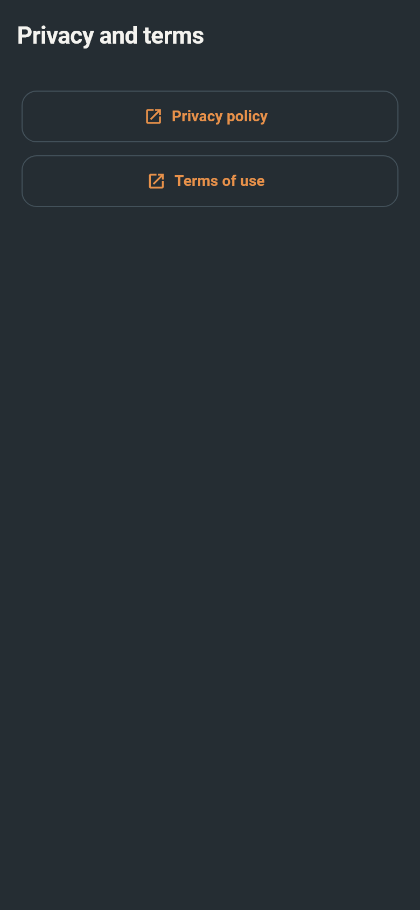
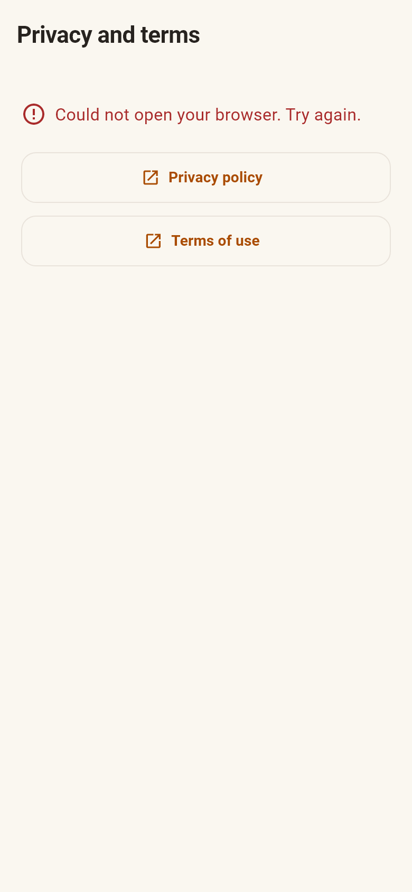
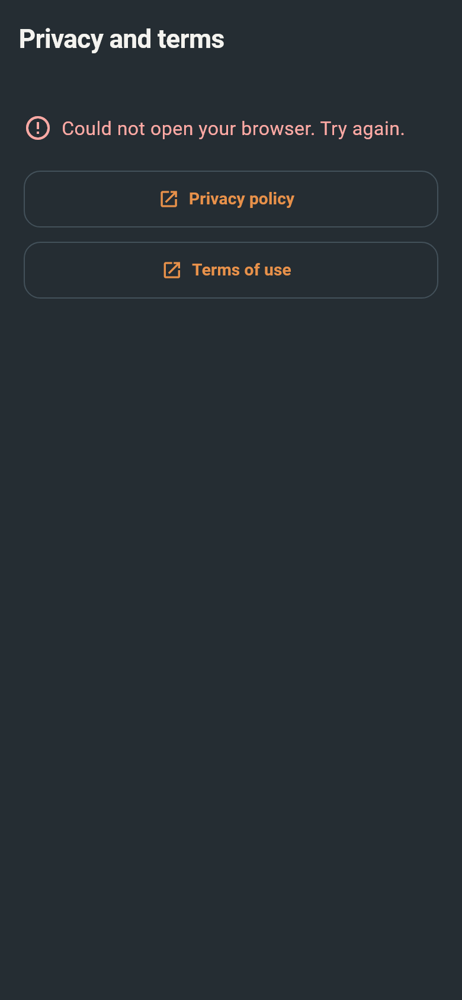
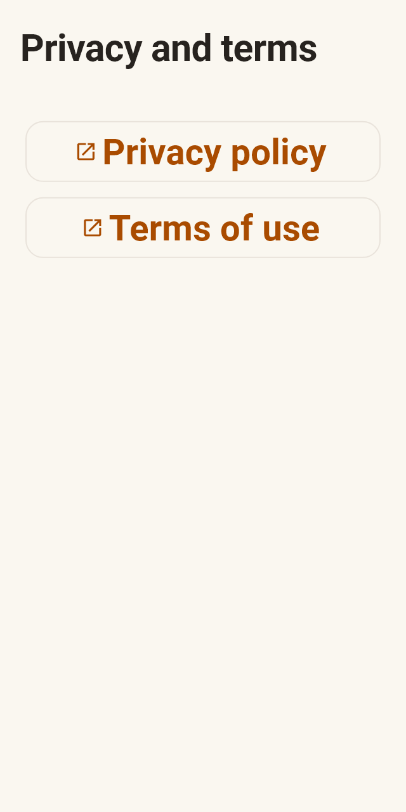
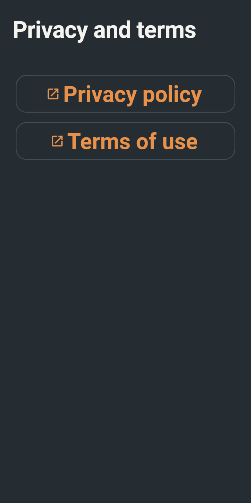

# Privacy and terms (#117)

The shared legal page now has two browser buttons. The same page is reached
from Settings, sign-up and account deletion. An unavailable browser leaves both
buttons in place and shows a retryable inline error.

| State | Light | Dark |
| --- | --- | --- |
| Ready |  |  |
| Browser unavailable |  |  |
| Narrow, enlarged text |  |  |

These are real Flutter widget renders with fictional in-memory fixtures. The
error case injects an unavailable browser; rendering never launches a browser.
They are not physical-device screenshots.

```sh
TZ=UTC flutter test scripts/render/render_screens_test.dart --name=privacy-and-terms
```
