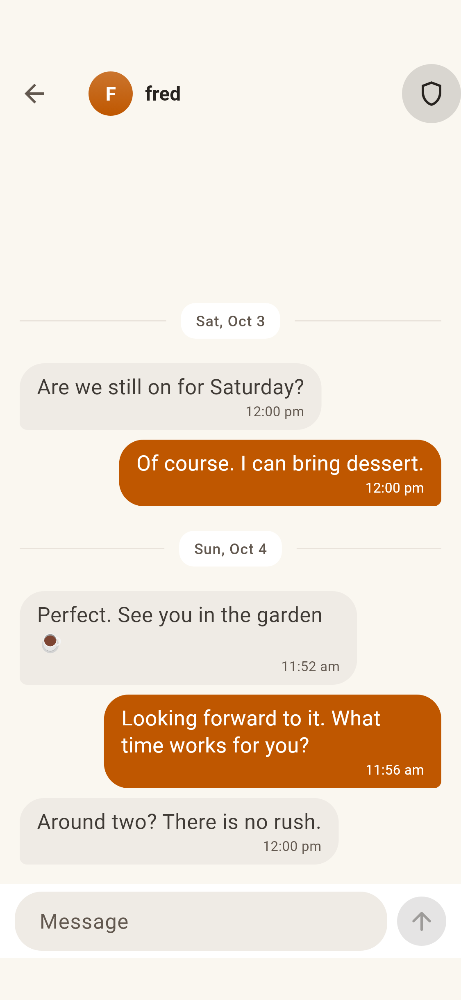
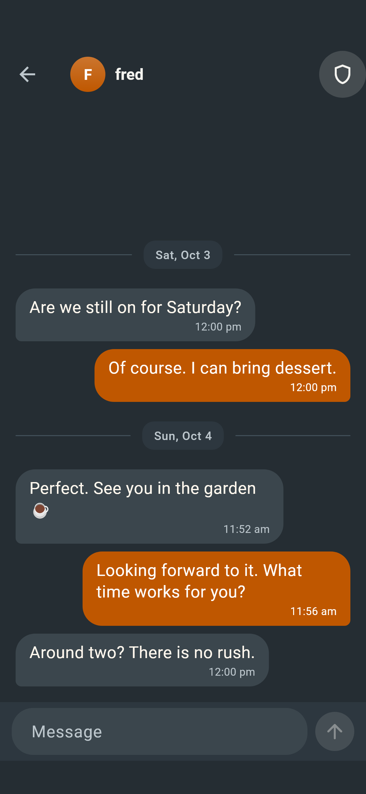
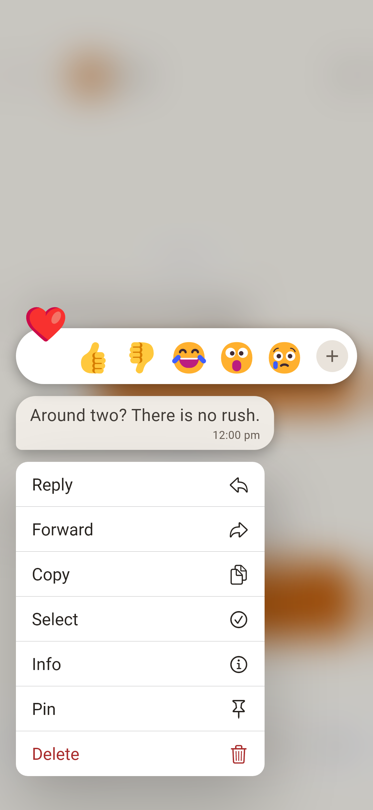
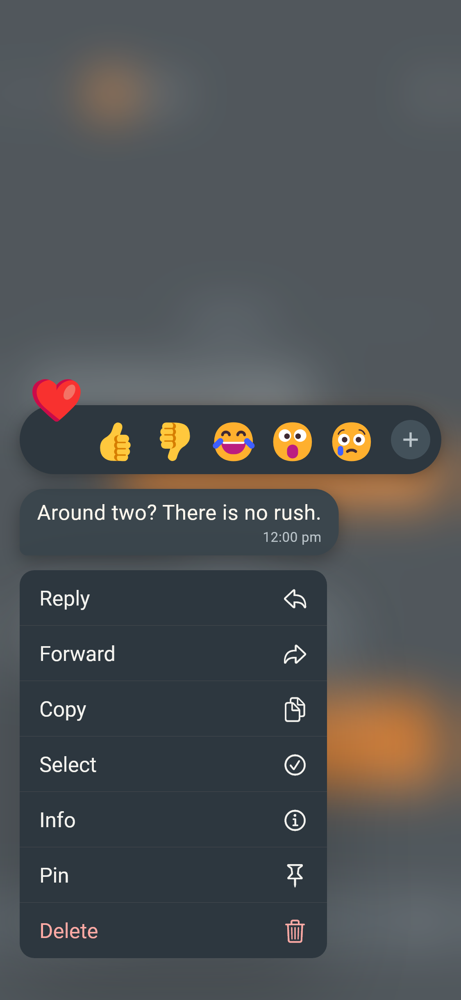
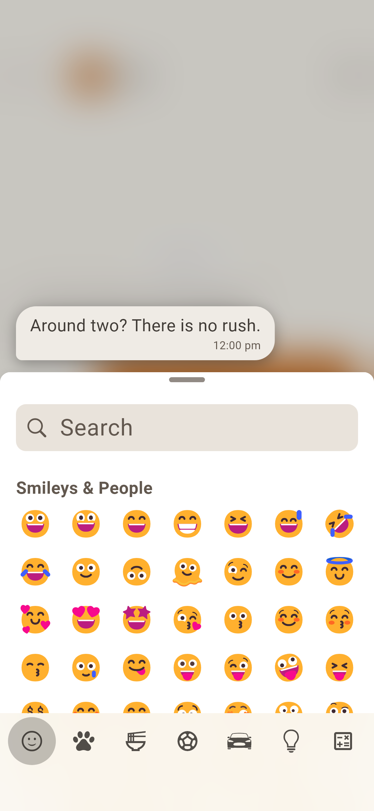
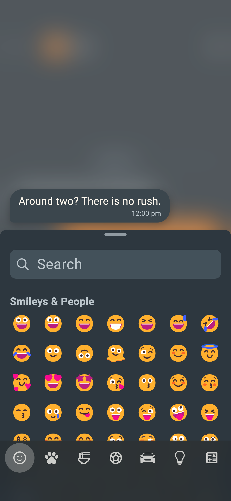

# Held icon labels (#121)

These are real widget renders with a finger held down beyond Flutter's
long-press threshold. Floating tooltip text is absent for the toolbar icon,
quick reaction, and emoji category icon. Message/chat hold interactions remain available.
All conversations are fictional fixtures.

| Held control | Light | Dark |
| --- | --- | --- |
| Verify security code |  |  |
| Quick reaction |  |  |
| Emoji category |  |  |

The reaction targets are now 48 × 56 and emoji category targets are 48 × 48.
The existing horizontal scrolling keeps the controls reachable on narrow
screens. Emoji glyphs use a preview-only system font and may differ on a phone;
no font is added to the app. These captures are not physical-device tests.

Reproduce with an installed emoji font for readable preview glyphs:

```sh
RENDER_EMOJI_FONT=/path/to/emoji-font.ttf TZ=UTC flutter test scripts/render/render_screens_test.dart --name=icon-held
```
