# Copy selected messages — issue #124

The production selection bar adds the held-message menu's copy icon immediately
left of Forward. Delete, Forward, Cancel, Delete All and the centered selected
count keep their positions. Copying leaves the selection active.

These are actual Flutter widget renders with fictional local fixtures, captured
on Windows. Each column explicitly targets the named platform, with phone safe
areas and 135% text. Latin text uses the SDK's Roboto preview font; emoji use an
installed preview fallback. No font is added to the app. These are not physical
Android or iPhone screenshots.

| State | Android, 360 × 800 | iOS, 375 × 812 |
| --- | --- | --- |
| One selected, light | 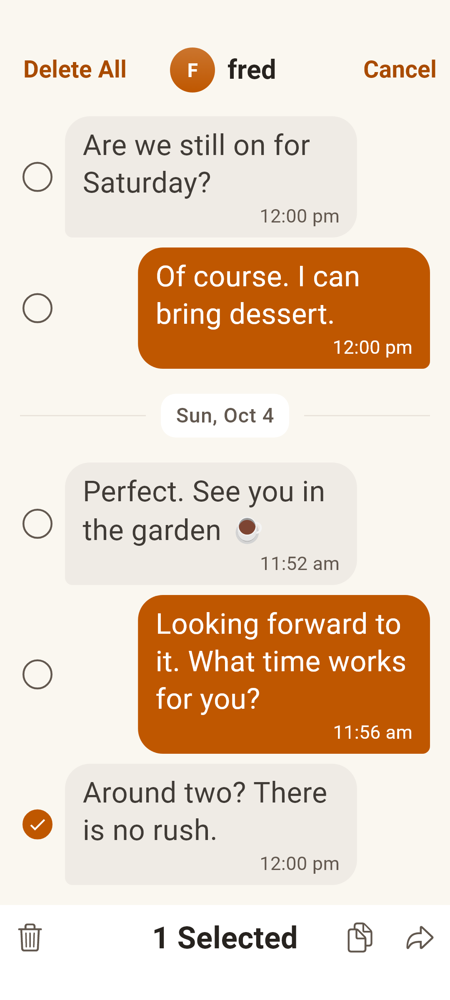 | 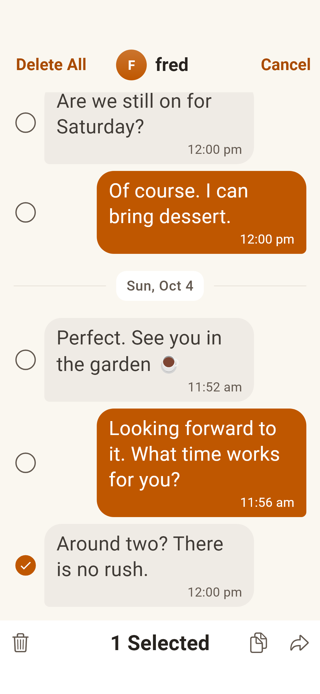 |
| Multiple selected, light | 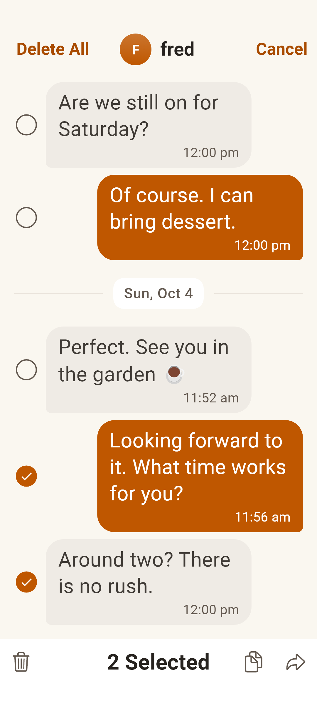 | 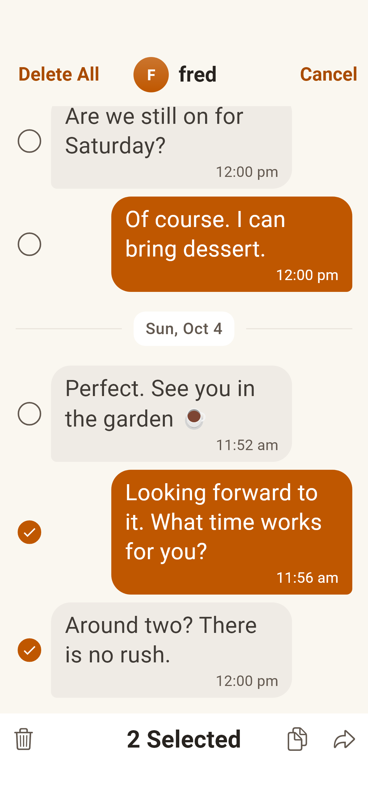 |
| Copied, light | 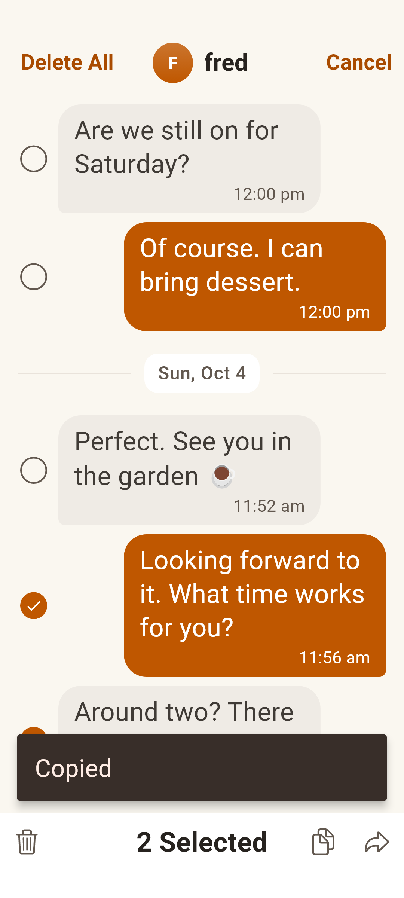 | 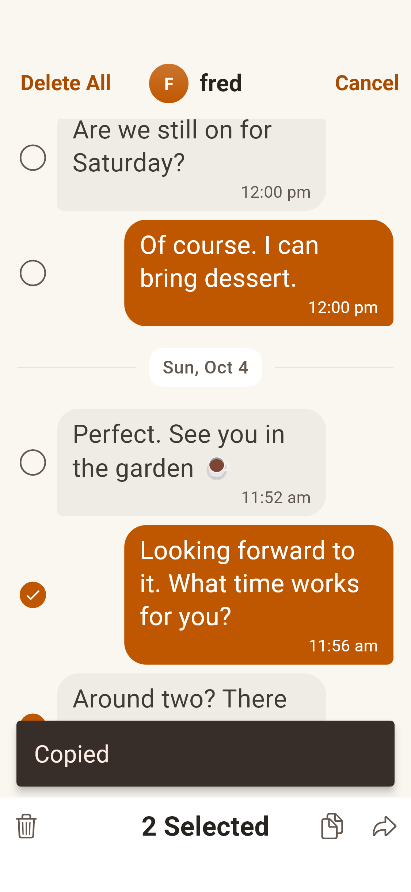 |
| One selected, dark | 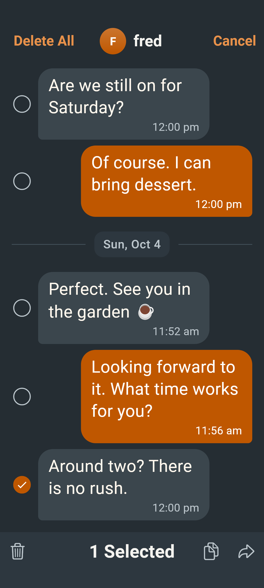 | 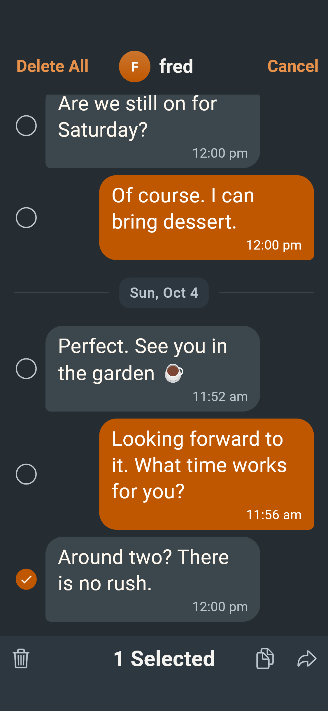 |
| Multiple selected, dark | 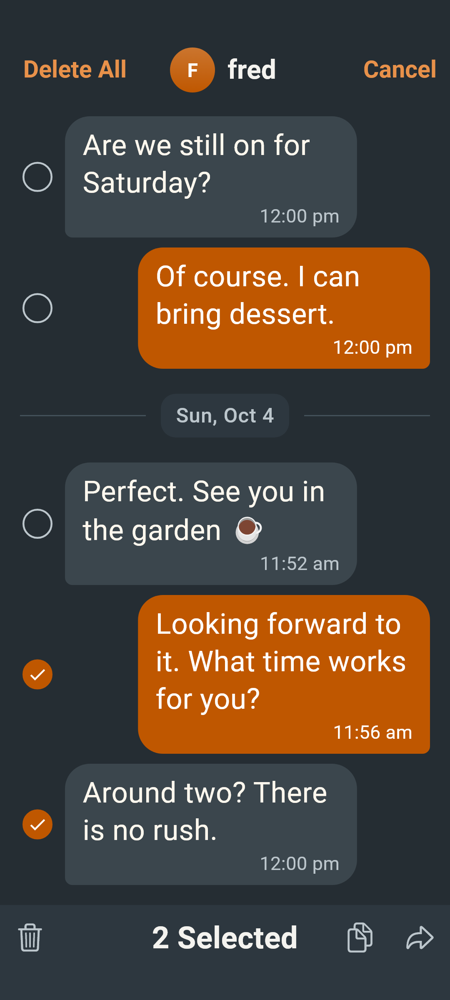 | 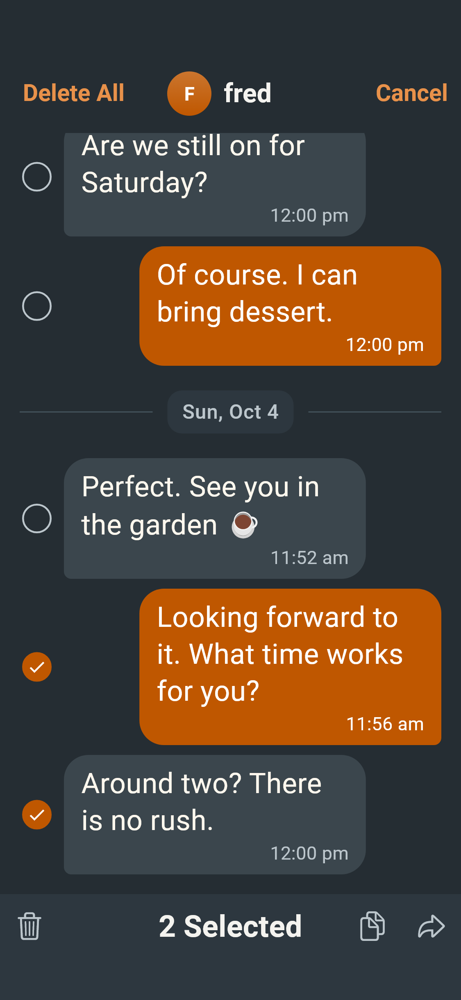 |
| Copied, dark | 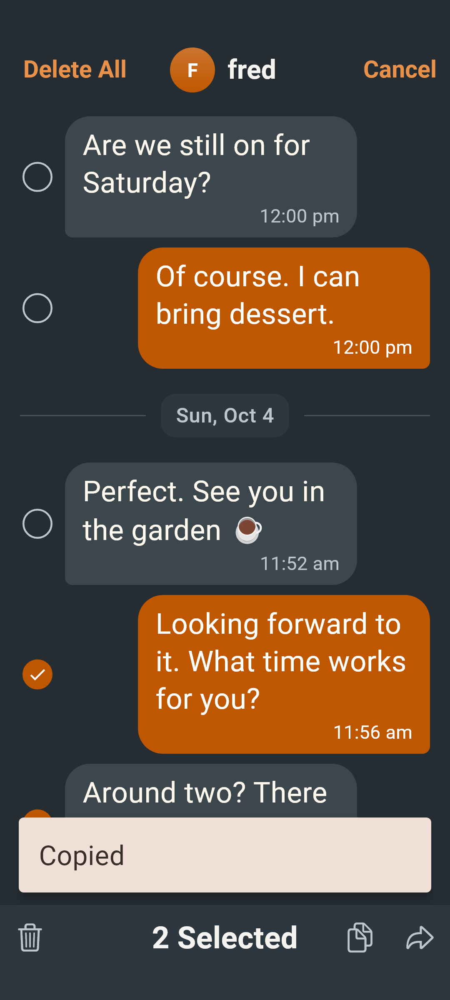 | 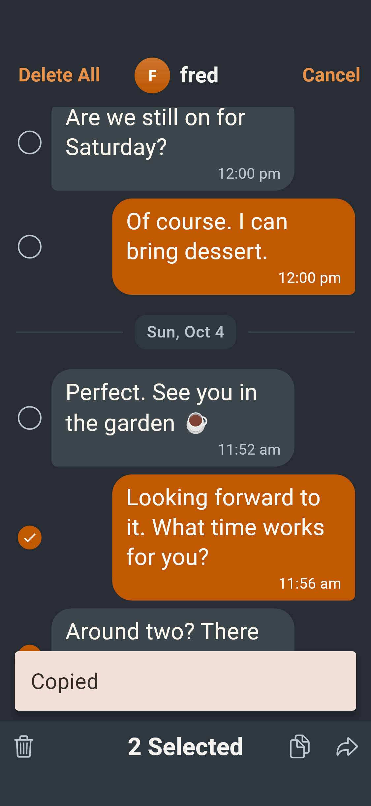 |

The platform render cases assert the actual target platform. Interaction tests
check plain text and display order, unreadable/deleted exclusions, empty copy,
failure and retry, retained selection and exact held-menu icon reuse. Geometry
checks cover both platforms and a 320-point phone at 200% text, including 48-point
targets and the unchanged center and outer controls.
