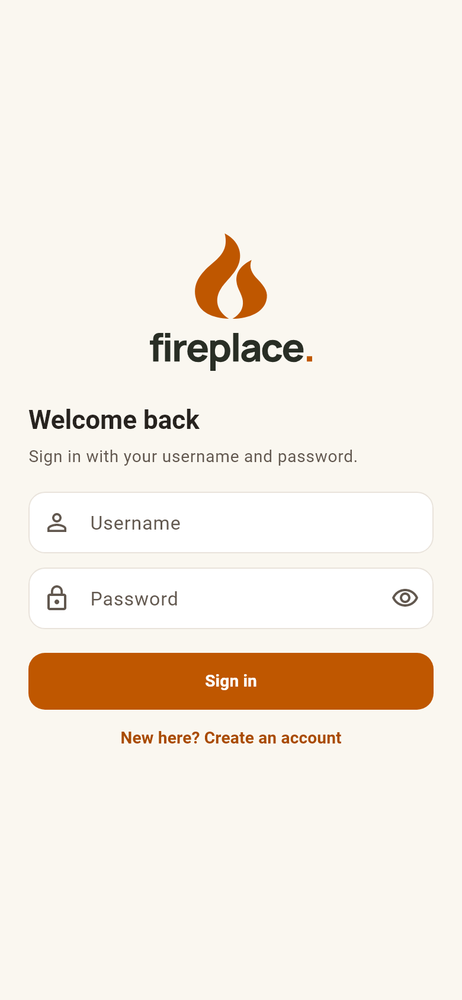
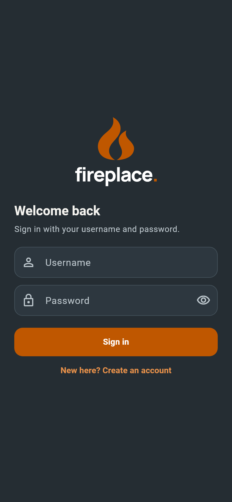

# Minimum startup duration — issue #148

The existing splash stays visible for at least three seconds during a normal
launch. Authentication, account preparation and chat-list warmup run alongside
that minimum. Loading that takes longer still controls when the app is ready;
there is no extra three-second wait afterward.

Recovery, account-deletion and startup-error actions stay available immediately.
Returning from a page, resuming the app and signing out do not restart the timer.
Reduced-motion preferences still disable animation.

These captures use the real AuthGate with a fictional, immediately ready signed-out
fixture. The first frame is captured at 2.5 seconds, when the previous code would
already have shown sign-in. The second is captured at 3.4 seconds after the ready
screen has appeared. Fake-clock tests verify the exact 3.000-second boundary;
screenshots alone cannot establish timing.

| Time | Light | Dark |
| --- | --- | --- |
| 2.5 seconds: splash still visible |  |  |
| 3.4 seconds: ready destination |  |  |

These are Flutter widget renders on Windows, not physical-device screenshots.
The logo and animation are the existing production artwork, not new mockups.

```sh
TZ=UTC flutter test scripts/render/render_screens_test.dart --name=startup-minimum
```
