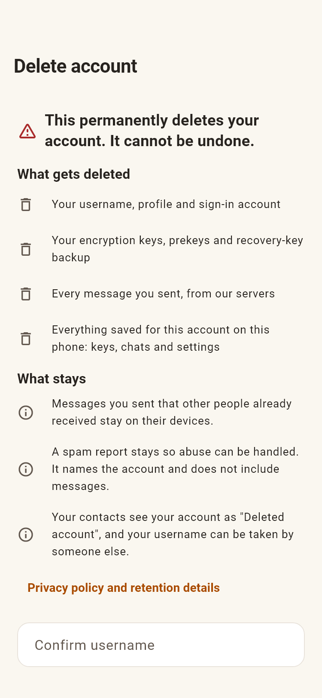
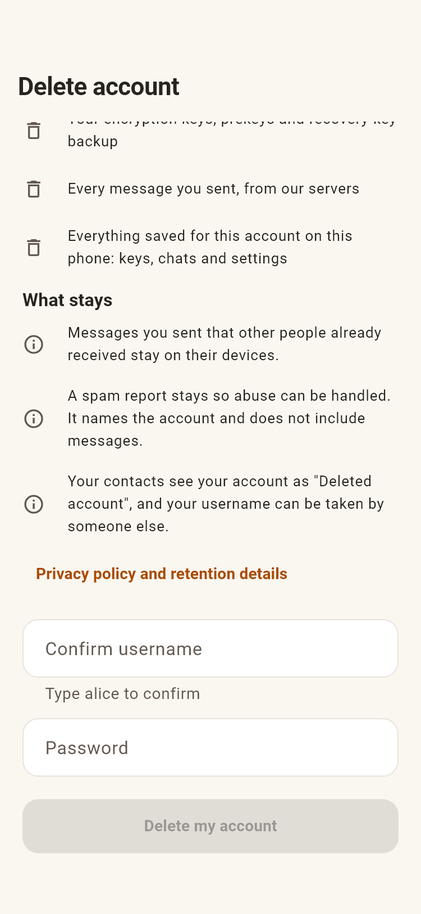
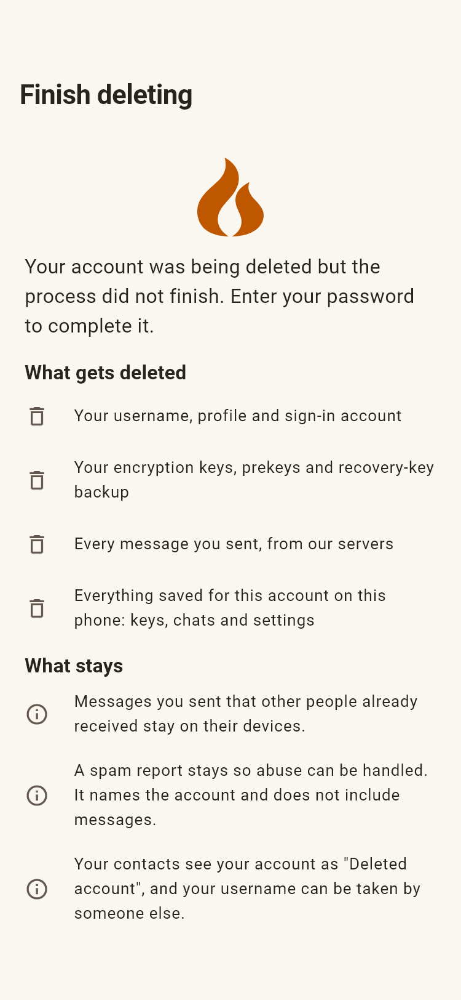
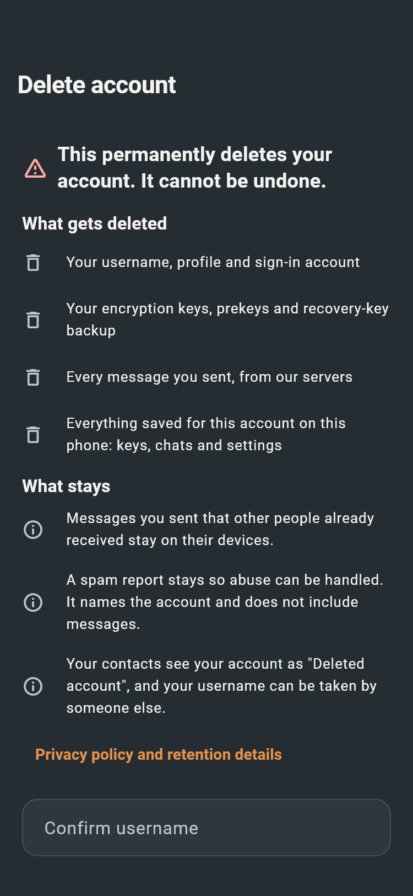
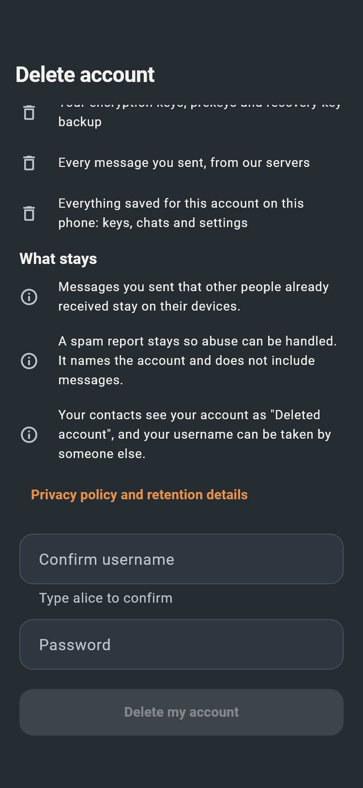
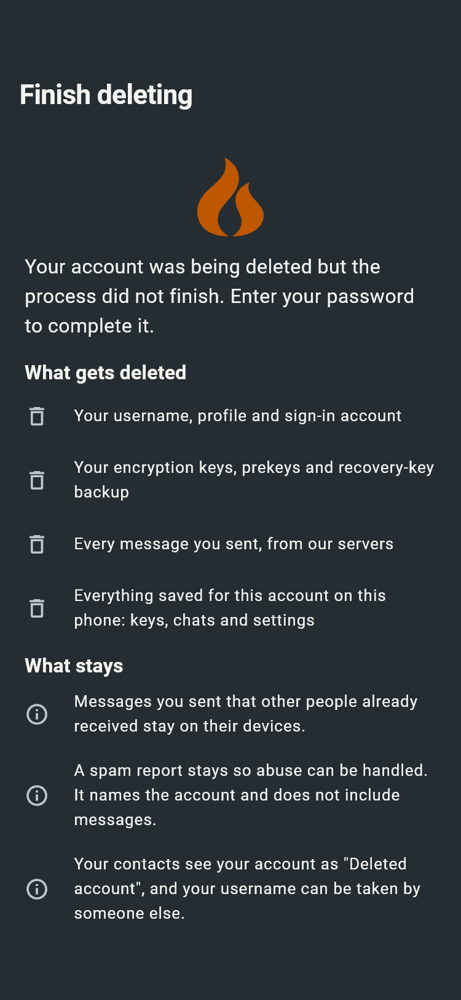

# Account deletion — issue #154

The client deletes known counter/proof paths directly, completes cleanup without
starting a crypto session, erases only the confirmed account, and explicitly
signs out after removing its Auth account. Incomplete deletion remains fenced.
The backend companion is [PR #33](https://github.com/fireplacechat/backend/pull/33).

The images below are actual Flutter widget renders with fictional fixtures,
captured on Windows. The iOS cases use the iPhone X's 375 × 812 logical viewport
and 44/34 safe areas. These are layout checks, not physical-device test evidence.
Android cases use the same constrained viewport to check the platform widgets.

| State | iOS | Android |
| --- | --- | --- |
| Explanation, light |  |  |
| Confirmation, light |  |  |
| Resume, light |  |  |
| Explanation, dark |  |  |
| Confirmation, dark |  |  |
| Resume, dark |  |  |

## Physical iPhone X verification required before release

Use the corrected signed app and the reviewed backend rules. Do not use an
important account for a destructive test.

1. Test two disposable accounts on the same phone. Give each its own theme,
   colours, sound/notification choices, and sent/received chat history. Sign out
   and back in between them to confirm each account's data before deletion.
2. Delete the first account from Settings with its username/password. Back
   navigation must be blocked while cleanup runs. On completion the sign-in
   screen must appear without requiring a manual signout or restart.
3. Confirm the deleted credentials cannot sign in again. Inspect that account's
   server paths and Auth record using the operator's read-only verification;
   confirm its sent message documents are absent, including all message pages.
4. Sign in to the second account. Its keys/security code, received history,
   theme, colours and other choices must be preserved. Opening a conversation
   with the deleted account must not erase this surviving account's history.
5. Repeat with a disposable account that is already on **Finish deleting**.
   The password retry must finish without loading a chat session or asking for
   a recovery key. Repeat after closing/reopening the app during cleanup and
   after a network interruption; the irreversible fence must persist.
6. After the two reported accounts finish deletion, verify their old credentials
   fail. Their pending profiles/Auth records have only been inspected during
   development; they have not been deleted by an operator.

Automated tests cover denied collection listing, duplicate submissions, 1,205
additional sent messages across multiple 400-document pages, interruptions at
each destructive boundary, keychain failure/retry, both history roots, cold
resume, auth signout, account switching, and byte-preservation of sibling data.
The real Firestore emulator tests cover cleanup after profile removal and reject
incoming-message reads once deletion starts.
