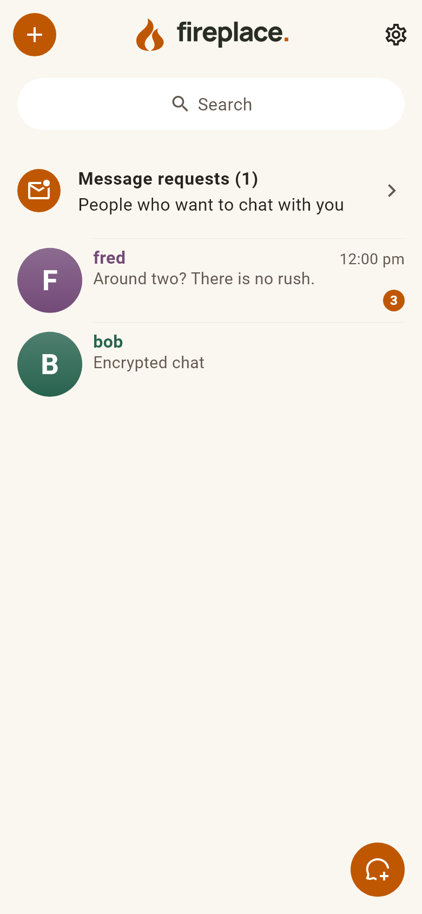
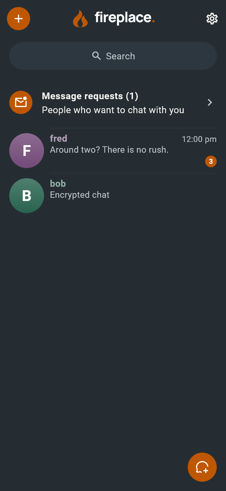
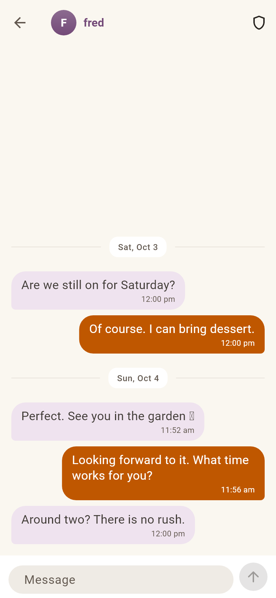
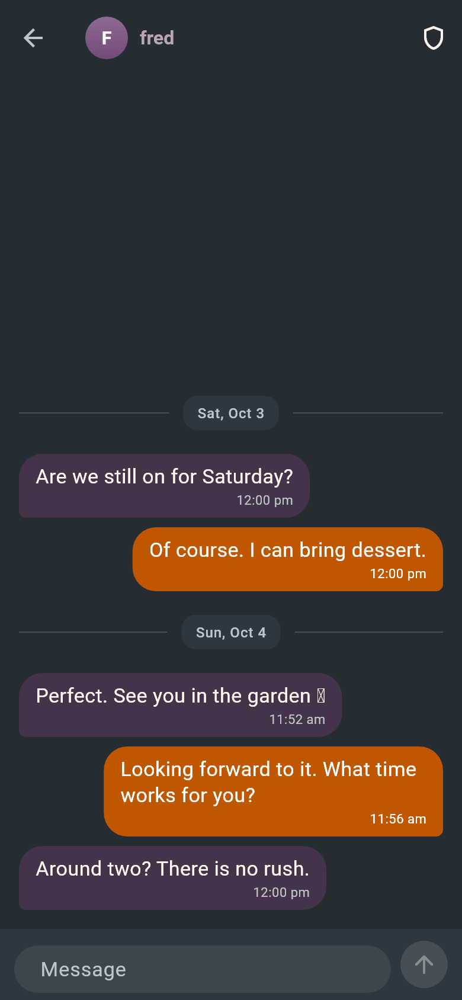
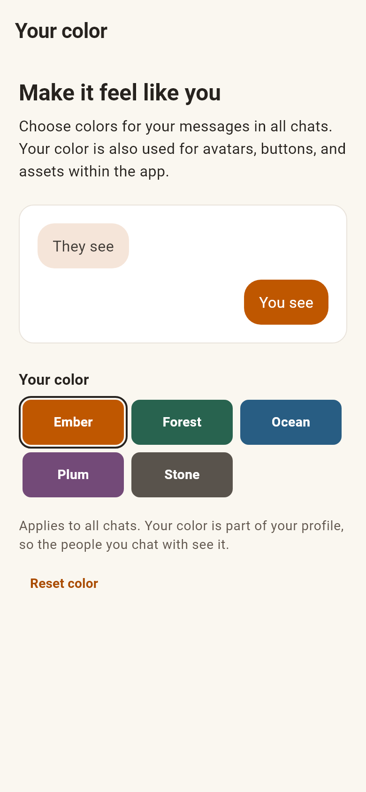
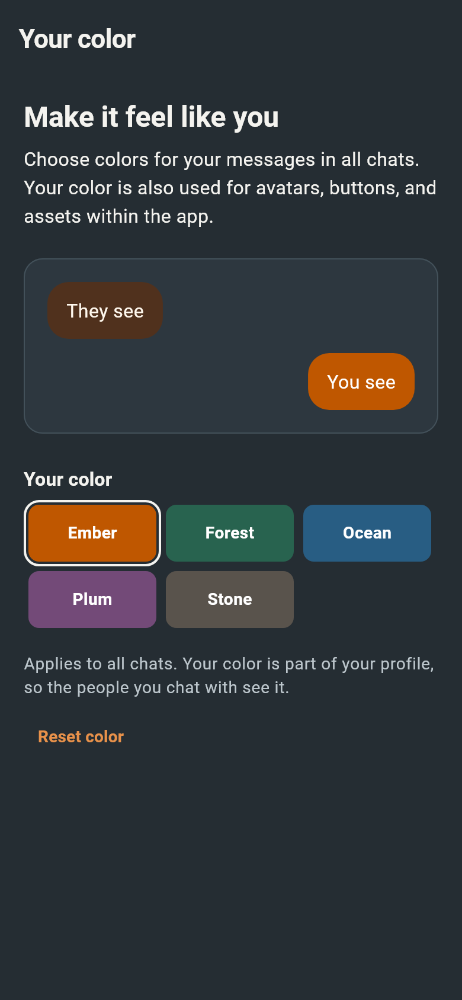

# A person's colour on their profile

Previews for [decision 0053](../../decisions/0053-colour-on-the-profile.md),
made with `TZ=UTC flutter test scripts/render/render_screens_test.dart`.

| What | Light | Dark |
| --- | --- | --- |
| Chat list: each accepted person's avatar and name in their colour (fred chose Plum, bob chose Forest) |  |  |
| Conversation: their avatar and name at the top, and their messages in the soft tint |  |  |
| Settings, Your color: the new line under the choice |  |  |
