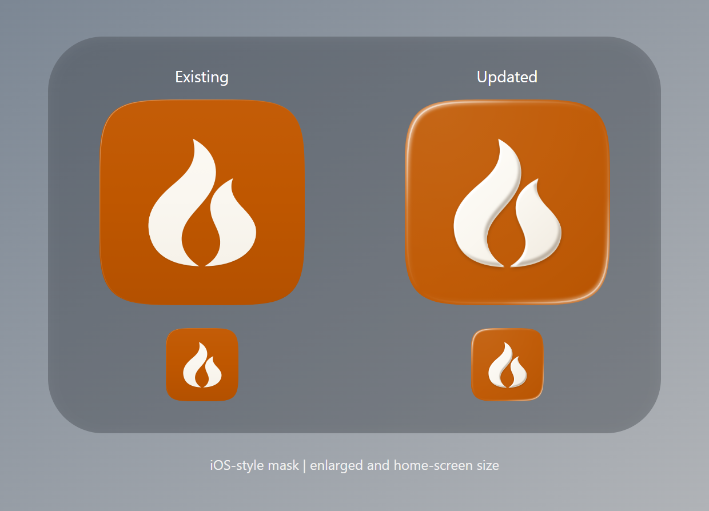

# iOS icon depth

The existing icon's edge lighting nearly disappears at home-screen size, and
the flame reads as flat. This update keeps the approved flame paths, scale and
position, adding a softly bevelled face and a small shadow beneath it. White
edge catches sit inside the iOS mask at the top-left and bottom-right. A broad,
low-opacity reflection gives the orange a very light glaze.

The comparison uses an illustrative iOS-style mask; the shipped assets remain
opaque, full-bleed squares, and iOS applies the actual mask. Physical iPhone
appearance should be reviewed with the next build.

Only the iOS master image, iOS icon catalogue and its renderer are changed.
Android assets, the in-app logo, and the website are unchanged. The owner has
requested a TestFlight update; `pubspec.yaml` is now 0.1.2+000102 so its upload
has a fresh version/build number. The release workflow must run from reviewed
main and retains its protected environment approval.

## Regeneration and checks

Run `flutter test scripts/render/render_app_icons_test.dart` with the pinned SDK.
Copy `build/icon-exports/fireplace_ios.png` to `assets/icon/fireplace_ios.png` and
the named catalogue exports into `ios/Runner/Assets.xcassets/AppIcon.appiconset/`.
Do not run the cross-platform launcher generator for this iOS-only change.

- `scripts/check.sh quick` passes with `PYTHONUTF8=1` on Windows: Dart format,
  Flutter analysis, layer checks and app-bundle refusal checks.
- Icon export test and both logo tests pass.
- All 25 catalogue entries have the expected dimensions, valid PNG CRCs and
  opaque RGB encoding, with only IHDR, IDAT and IEND chunks. No C2PA metadata.
- The iOS master matches the 1024px catalogue export byte for byte.

Codex implemented the vector-rendering changes and validation. Artwork is a
code export of the approved flame, without generative image assets.
