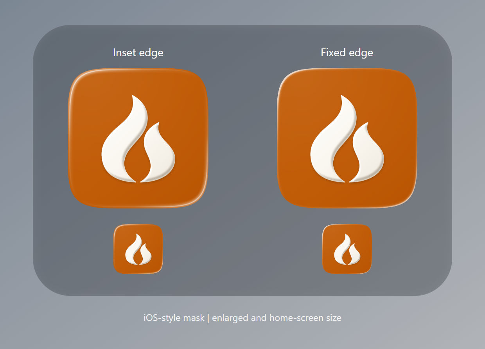

# iOS icon edge correction

The 0.1.2 highlight was an inset stroke: its brightness dropped back to orange
before the outer mask, leaving a visible strip around the white edge. The new
bevel fills outward through the mask instead, so there is no orange strip beyond
the highlight. The full-square export stays opaque for iOS to apply its mask.

The flame, its shadow and the central orange are pixel-identical to the 0.1.2
icon. Android assets and the website are unchanged. Version 0.1.3+000103 reserves
a fresh build number for the corrected TestFlight build.

The regression test follows both lit corners outward at 1024, 180, 120 and
60 pixels. It fails on the old inset stroke and passes on the new edge fill.
The export test verifies opaque pixels and a lossless RGB PNG round trip.
`scripts/check.sh quick` passes with `PYTHONUTF8=1` on Windows.

The preview uses an illustrative iOS-style mask. Actual device appearance still
needs verification after the next TestFlight build. No upload has been started
for this correction.

AI assistance: Codex changed the existing vector renderer and ran the checks.
No generative image artwork was used.
